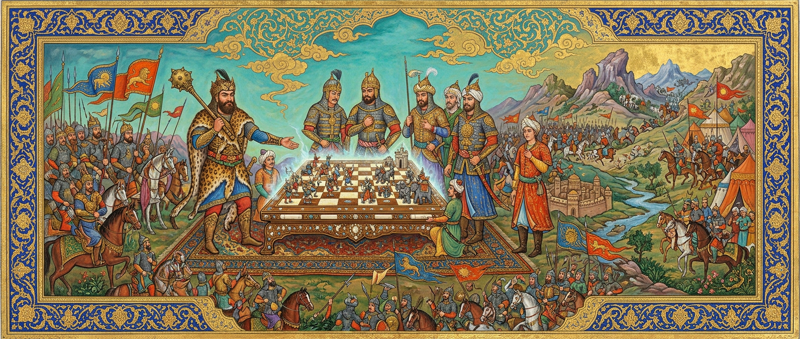

# شاه‌مات ⚔️

**نبرد اساطیر ایران‌زمین بر صفحه‌ی سرنوشت** — یک بازی تخته‌ای نوبتی در سبک شطرنج، با مهره‌هایی از شاهنامه: رستم، سهراب، زال، اسفندیار، آرش کمانگیر و... که هرکدام حرکت و قابلیت ویژه‌ی خودشان را دارند.



## ✨ ویژگی‌ها

- **صفحه‌ی ۸×۸ با روح شاهنامه** — قوانین کلاسیک شطرنج نیست؛ هر مهره الگوی حرکت اختصاصی و یک قابلیت فعال با زمان بازیابی دارد
- **سیستم چیدن تیم با امتیاز** — قبل از بازی با ۲۴ امتیاز، ۸ قهرمان از بین ۱۳ قهرمان انتخاب می‌کنی (کی‌خسرو، شاه، رایگان و اجباری است)
- **آرایش آزاد مهره‌ها** روی دو ردیف خودی — استراتژی از همان اولین قدم
- **قابلیت‌های خاص**: تیر آرش (شلیک در خط دید)، گرز دستان (ضربه بدون حرکت)، مهر سیمرغ (زنده کردن مهره‌ی از‌دست‌رفته)، زنجیر اسفندیار (قفل دشمن)، نیرنگ گردافرید (جابه‌جایی با دشمن) و...
- **دو حالت بازی**: نبرد با کامپیوتر و دو‌نفره‌ی محلی (hot-seat)
- **رابط کاملاً فارسی/راست‌چین** با زیبایی‌شناسی کاشی‌کاری فیروزه‌ای و طلایی و پرتره‌های مینیاتوری

## 🎮 قواعد خلاصه

1. هر بازیکن: **شاه + ۸ قهرمان** (خرید امتیازی، حداکثر ۲ نسخه از هر قهرمان)
2. مهره‌ها را روی دو ردیف خودی می‌چینی
3. در هر نوبت: **یک حرکت + حداکثر یک قابلیت**
4. گرفتن = حرکت روی خانه‌ی دشمن؛ برخی اثرها (سپر، مصونیت) مانع گرفته‌شدن می‌شوند
5. **هرکس شاه حریف را بگیرد، برنده است.** کیش و مات در کار نیست!

## 🦸 رستر قهرمانان

| قهرمان | هزینه | قابلیت |
|---|---|---|
| کی‌خسرو (شاه) | اجباری | الهام شاهانه — حرکت دوباره |
| رستم | ۶ | گرز دستان — ضربه بدون حرکت |
| سهراب | ۵ | شور جنگ — حرکت جایزه پس از گرفتن |
| اسفندیار | ۵ | زنجیر — قفل کردن دشمن |
| آرش کمانگیر | ۴ | تیر آرش — شلیک در خط دید تا ۶ خانه |
| زال | ۴ | مهر سیمرغ — زنده کردن مهره (یک‌بار در بازی) |
| سیاوش | ۴ | آزمون آتش — مصونیت |
| گردافرید | ۳ | نیرنگ جنگ — جابه‌جایی با دشمن |
| بیژن | ۳ | خشم — بُرد حرکت بیشتر |
| طوس | ۳ | آرایش سپاه — جابه‌جایی با هم‌تیمی |
| گیو | ۳ | پیک تند — جهش دور |
| فرامرز | ۳ | سپر خاندان — محافظت از هم‌تیمی |
| کماندار | ۲ | تیراندازی — شلیک تا ۴ خانه |
| سرباز | ۱ | جسارت — حرکت دوباره |

جزئیات کامل طراحی در [GAME_DESIGN.md](GAME_DESIGN.md) آمده است.

## 🛠 اجرا

```bash
npm install
npm run dev      # اجرای توسعه (مرورگر)
npm test         # تست‌های موتور بازی
npm run build    # بیلد نهایی
```

## 🧱 معماری

```
src/
├── game/           # موتور بازی خالص (بدون وابستگی به UI)
│   ├── types.ts    # تایپ‌ها و ثابت‌ها
│   ├── heroes.ts   # رستر قهرمانان: حرکت‌ها، قابلیت‌ها، هزینه‌ها
│   ├── engine.ts   # قوانین، حرکت‌ها، قابلیت‌ها، برد
│   ├── ai.ts       # هوش مصنوعی و چیدن تیم خودکار
│   └── engine.test.ts
├── components/     # رابط کاربری (منو، خرید تیم، آرایش، نبرد)
└── lib/fa.ts       # ابزارهای نمایش فارسی
```
